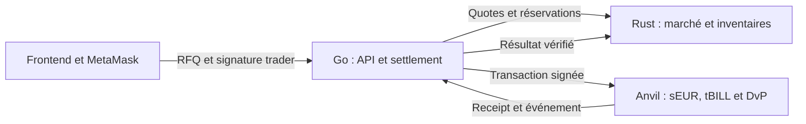

# rfq-dvp-market

Marché RFQ pédagogique pour acheter ou vendre un titre fictif **tBILL** contre du cash fictif **sEUR**, avec un moteur Rust, un backend Go et un settlement atomique Solidity sur Anvil.

Le projet sert à comprendre comment une décision de marché off-chain devient un échange on-chain autorisé par les deux contreparties. Trois market makers simulés proposent des prix calculés, puis le trader choisit une quote et signe ses termes dans MetaMask.

## Ce qui fonctionne

- BUY et SELL, en quantité exacte de tBILL ou en budget maximal / cash minimum sEUR, avec six décimales.
- Quotes identifiées et expirables, classement du meilleur prix et réservations atomiques dans Rust.
- Signatures EIP-712 trader/MM, transaction envoyée par Go, vérification du receipt et comptabilité idempotente.
- Interface affichant compte, soldes, résultat et transaction hash ; parcours local confirmé par l'auteur.
- Tests de concurrence, expiration, replay, transferts atomiques et réponses perdues ; scénario réel BUY/SELL sur Anvil.



## Lire et lancer

Depuis PowerShell, après installation des [prérequis et dépendances](docs/development.md) :

```powershell
.\scripts\demo.ps1
```

Un seul terminal compile et lance Anvil, déploie les contrats, puis démarre Rust, Go et le frontend. Ouvre **http://127.0.0.1:5173**, connecte ton compte MetaMask de test et signe un trade. **Ctrl+C** arrête les services. Chaque lancement recrée une session avec les soldes initiaux ; les logs sont dans `.cache/demo/`.

1. [Lancer la démo et les tests](docs/development.md) : prérequis, commandes PowerShell et MetaMask.
2. [Comprendre le projet](docs/architecture.md) : exemple de trade, rôles Go/Rust/Solidity, pricing, sécurité et persistance.
3. [État et prochaines étapes](docs/progress.md) : validations datées, limites et objectif portfolio.
4. [Référence API et signatures](docs/api.md) : à consulter pour travailler sur le code, sans lecture préalable obligatoire.

## Parcourir le code

- `market-engine/src/domain/` : montants exacts, pricing, RFQs et transitions sous verrou.
- `backend/internal/httpapi/` : routes et vérification avant réservation.
- `backend/internal/signing/` : termes EIP-712 et signatures des MM de démonstration.
- `backend/internal/settlement/` : transactions, nonces, receipts et notification à Rust.
- `contracts/src/` : tokens et contrat DvP ; `contracts/test/` : tests Foundry.
- `web/src/` : interface TypeScript, wallet et vérification des termes.
- `scripts/` : tests intégrés reproductibles ; `loadgen/` reste une intention, pas un outil livré.

## Portée et portfolio

L'objectif est un dépôt public GitHub permettant de comprendre, exécuter et discuter le projet. Le travail porte sur la cohérence de l'inventaire, la frontière entre signature et transaction, et les échecs aux frontières entre services. L'implémentation est assistée par IA ; l'objectif de l'auteur est d'en comprendre et défendre les choix.

Cette version est une **démo locale**, pas une infrastructure de production : tokens sans valeur réelle, comptes Anvil publics, API internes de confiance et état Go/Rust en mémoire. Un redémarrage avec perte d'état exige une réinitialisation coordonnée. Pas de base de données, reprise durable, load generator, métriques, CI ou déploiement Sepolia livrés. Publier le code sur GitHub n'exige pas de rendre ces API accessibles sur Internet.
