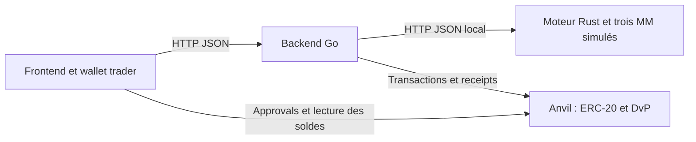

# Architecture

## État actuel

Le skeleton expose deux serveurs indépendants : Go sur `127.0.0.1:8080` et Rust sur `127.0.0.1:8081`. Chacun répond à `GET /healthz` par `200`, avec le JSON `{"status":"ok"}`. Le routage prend aussi en charge HEAD selon les conventions HTTP ; POST est refusé. Aucune dépendance externe n'est sondée.

Vite sert une page statique sur `127.0.0.1:5173`. Foundry est configuré, mais aucun contrat n'existe. Aucun appel Go vers Rust ou vers Anvil n'est encore effectué.

## Cible de la première slice

### Go : infrastructure et orchestration

Un seul backend contient l'API externe, le client HTTP du moteur, les signers MM simulés et le module de settlement. Ces responsabilités sont séparées en packages lorsqu'elles apparaissent ; aucun répertoire métier vide n'est créé par anticipation.

Go valide la forme des requêtes, transporte les décisions Rust, construit les transactions et observe leurs receipts. Il ne choisit ni les prix ni les allocations. Un seul submitter gère initialement les nonces de son compte Ethereum. Les signers MM sont des comptes distincts du compte submitter, même si leurs clés de test sont hébergées dans le même processus.

### Rust : propriétaire de l'état de marché

Rust possède les configurations MM, le pricing, les RFQs, les quotes, les réservations, les trades et leurs transitions métier. Le serveur HTTP est un adaptateur ; le futur domaine sera un module indépendant d'Axum, testable sans réseau.

Le choix initial est un état en mémoire protégé par `Arc<Mutex<MarketState>>`. `Arc` partage le même état entre handlers ; le `Mutex` rend atomique une transition qui consulte puis modifie plusieurs valeurs. Les requêtes arrivent concurremment, mais deux réservations ne peuvent pas lire simultanément le même inventaire disponible puis le dépenser toutes deux.

Le verrou ne couvre que du calcul court. Aucun appel HTTP, blockchain, signature ou `await` sous verrou. Les résultats sont copiés avant de répondre. Une contention mesurée pourra justifier une évolution ; aucun actor framework, sharding ou système de channels métier n'est nécessaire au départ.

### Solidity : autorisation et transferts

La chaîne fait autorité sur les soldes et sur l'exécution du DvP. Le contrat vérifie les termes signés, la deadline et l'absence de replay, puis effectue les deux transferts ou aucun. Il ne recalcule pas les quotes et ne connaît pas la comptabilité interne de Rust.

Go rapporte à Rust les faits observés sur la chaîne. Rust applique une transition valide et met à jour ses inventaires ; il ne traite pas un simple succès d'envoi RPC comme un settlement confirmé.

## Interfaces futures, sans schéma figé

- Frontend vers Go : demander des quotes (wallet, sens, quantité), consulter le résultat, accepter une quote avec les termes signés, consulter un trade et son transaction hash.
- Go vers Rust : créer/consulter une RFQ, accepter et réserver atomiquement une quote, consulter un trade, communiquer un résultat de settlement identifiable.
- Go vers Anvil : lire soldes/allowances, soumettre un DvP signé, consulter receipts et état de consommation du trade.

Les réponses transporteront des identifiants stables (`rfq_id`, `quote_id`, `trade_id`), les termes exacts, les deadlines et des erreurs distinguant refus métier et indisponibilité. Les montants JSON seront des chaînes. Le moteur revalidera les invariants même si Go a déjà validé la requête. Le détail des routes et DTO sera spécifié avec la slice, sans SDK généré aujourd'hui.

Les services écoutent seulement en local. Une adresse de wallet déclarée dans une requête ne constitue pas une authentification. L'API interne suppose un environnement local de confiance.

## Évolution reportée

La phase 2 ajoutera PostgreSQL et la reprise, sans dupliquer les décisions de marché dans Go. Avant cela, une décision dédiée devra préciser comment les transitions Rust deviennent durables et sont restaurées : ajouter une base au backend ne rend pas automatiquement le moteur durable.

gRPC pourra remplacer HTTP/JSON si le besoin de contrats générés apparaît. WebSocket, queues durables, métriques, dashboard et loadgen attendent la phase 2. Aucun réseau de microservices supplémentaires n'est prévu.
