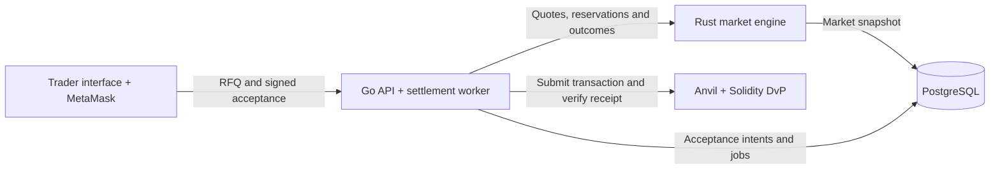

# Architecture

The market trades fictional tBILL against sEUR. Each request for quote (RFQ) asks three simulated market makers for a price. Each quote covers the full trade. The trader can choose any executable quote.

## Components and trade flow



1. The trader asks for a quote. Go validates the request and forwards it to Rust over HTTP/JSON.
2. Rust calculates maker prices and returns eligible quotes. A quote has a deadline and does not reserve inventory.
3. The trader picks a quote and signs its exact economic terms in MetaMask. Go verifies the signature and, in persistent mode, records the acceptance intent.
4. Rust checks that the quote is still valid and can be filled. It reserves the outgoing asset before acknowledging acceptance.
5. Go signs the same terms on behalf of the simulated maker and queues settlement. The worker submits the transaction to Anvil.
6. The DvP contract checks both signatures and exchanges the tokens atomically. Go verifies the on-chain result before Rust applies it to inventory. The frontend displays the result.

A reservation is a commitment in the market engine. The tokens stay in the participants' wallets until settlement. Token allowances let the contract transfer them, while the two signatures authorize the amounts and counterparties of a specific trade.

## Pricing and concurrent reservations

The reference price discounts the face value using the configured annual rate and time to maturity:

```text
reference price = face value / (1 + rate * years to maturity)
```

Each market maker shifts its mid-price based on how far its booked tBILL inventory is from its target, then applies its own spread. A maker with excess tBILL lowers its prices, making its sell quotes more competitive. For a BUY, Rust ranks the lowest ask first. For a SELL, it ranks the highest bid first. Ties are resolved by maker ID.

Amounts use integer units with six decimals. When the trader specifies cash, BUY rounds the security quantity down to stay within budget, while SELL rounds it up to meet the requested proceeds. The accepted quote fixes the amounts used at settlement.

Rust checks availability and writes the reservation under one lock. For example, if a maker has 150 tBILL available and two traders try to buy 100 each from it, at most one can reserve that stock. A BUY reserves the maker's tBILL, a SELL reserves the maker's sEUR. The incoming asset becomes available after settlement.

## Persistence and recovery

| Store | Writer | What is saved |
|---|---|---|
| `market_state` | Rust | RFQs, quotes, trades, inventories and reservations in one atomic snapshot |
| `acceptance_intents` | Go | The verified trader signature and trade identifiers before reservation |
| `settlement_jobs` | Go | Authorized calldata, signed transaction, nonce and hash, and verified chain result as the job progresses |

The services use the [database schema](../migrations/001_durability.sql) to store the market's identity and check it at startup. Each component allows one active writer per database.

Go persists the signed transaction **before** broadcasting it. If Anvil receives the transaction but Go loses the reply, Go can look up the original hash and resend the same bytes if needed. It records verified chain evidence before telling Rust the outcome. Repeating that notification does not apply the inventory change twice.

On restart, Go reloads unfinished work and reconciles with Rust and the chain before admitting new requests. An acceptance that was durably recorded can resume without the browser. If settlement is uncertain, the reservation stays in place until chain evidence resolves it. A database failure or an unexplained balance mismatch pauses new work so the application can recover against its durable state.

The recovery tests kill real Go and Rust processes while keeping PostgreSQL and Anvil alive. The suite exercises crashes around reservation, signing, broadcast, inclusion and accounting. It checks that retrying leads to one settlement and one inventory update for a successful trade.

## Design trade-offs and scope

- **One Rust lock and full snapshots.** A single critical section makes the inventory invariant easy to enforce. In persistent mode it also covers the database write. Larger retained RFQ history increases the cost of each snapshot.
- **One Go settlement worker.** Serial submission simplifies nonce management and replay. The polling interval and single worker contribute to the observed settlement latency. See [the local measurements](performance.md).
- **Two sources of state.** PostgreSQL stores off-chain decisions and Anvil stores token transfers. Durable retries and idempotent updates connect them. Recovery assumes the same database and chain history.
- **Local trust model.** The frontend connects a test trader and Go holds the demo market-maker signers. The internal API trusts local callers. The contract enforces signed terms, timing and atomic transfers. Public-network finality, custody and authentication are outside this simulation.

The services expose HTTP metrics on `/metrics`. Go also reports settlement work and retries. See [the API reference](api.md) for routes and signed terms.
